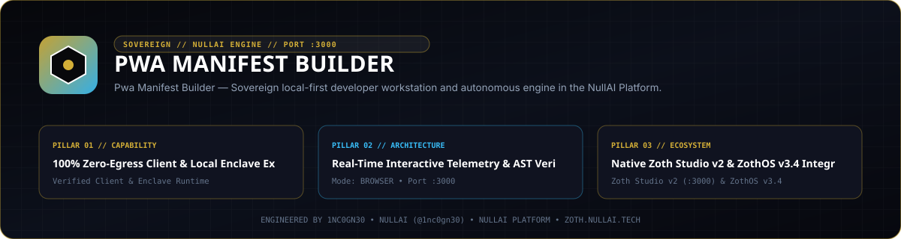

# PWA Manifest Builder



Zero-dependency W3C Progressive Web App (`manifest.webmanifest`) compiler, offline ServiceWorker (`sw.js`) generator, SVG/maskable icon forge, Web Share Target and File Handling API validator, installability linter, and Model Context Protocol (MCP) server.

- **Local Workstation**: `http://127.0.0.1:8100`
- **Zoth Studio v2 Dossier**: [https://zoth.nullai.tech/tools/pwa-manifest-builder](https://zoth.nullai.tech/tools/pwa-manifest-builder)
- **Repository**: [https://github.com/1nc0gn30/pwa-manifest-builder](https://github.com/1nc0gn30/pwa-manifest-builder)

## Overview

PWA Manifest Builder is engineered in pure Python 3.9+ standard library modules (`json`, `zipfile`, `http.server`, `urllib`) paired with a standalone in-browser Studio UI. It generates, validates, and packages installable Progressive Web App configurations across Chromium, WebKit (iOS/iPadOS Safari), and Gecko runtimes.

Core capabilities:
- **W3C Web App Manifest Synthesis**: Generates `manifest.webmanifest` payloads supporting `display_override` (`window-controls-overlay`, `tabbed`), `id`, `scope`, `orientation`, `categories`, `screenshots`, and `related_applications`.
- **ServiceWorker Strategy Compiler**: Produces ready-to-deploy `sw.js` workers across `cache-first`, `network-first`, `stale-while-revalidate`, `cache-only`, and `network-only` strategies with offline fallback routing and Background Sync hooks.
- **Maskable & Adaptive Icon Forge**: Synthesizes multi-resolution SVG and maskable safe-zone (`80%` inner circle) icon suites (`48x48` through `512x512`) plus Apple touch and favicon `<head>` link tags.
- **Desktop & OS Integration Validators**: Validates and simulates `shortcuts`, custom `protocol_handlers` (`web+*`), `share_target` (`GET` and `multipart/form-data` `POST`), and `file_handlers` (`launchQueue` MIME mappings).
- **Installability Linter (`0–100`)**: Audits existing manifests against W3C specs and Lighthouse installability criteria.

## Architecture

```text
pwa-manifest-builder/
├── server.py                                 # Standalone loopback workstation entrypoint (127.0.0.1:8100)
├── bin/
│   ├── pwa-builder.js                        # Unified CLI, Web UI, and Electron desktop launcher
│   └── pwa-manifest-builder-tui              # Terminal dashboard launcher
├── public/                                   # Zero-egress browser PWA Manifest Studio UI
├── src/pwa_manifest_builder/
│   ├── manifest_generator.py                 # W3C manifest.webmanifest & HTML <head> tag compiler
│   ├── serviceworker_generator.py            # Offline caching strategy & sw.js script generator
│   ├── icon_forge.py                         # Procedural SVG & maskable safe-zone icon generator
│   ├── shortcuts_simulator.py                # App shortcuts & custom protocol_handlers validator
│   ├── share_and_file_handlers.py            # Web Share Target & File Handling launchQueue validator
│   ├── linter.py                             # 0-100 installability & Lighthouse readiness auditor
│   ├── catalog.py                            # Domain preset templates (SaaS, E-Commerce, Media, Docs)
│   ├── mcp_server.py                         # JSON-RPC 2.0 stdio MCP server (13 tools + 3 prompts)
│   ├── ui_server.py                          # Threading HTTP REST API & Studio server (:8100)
│   └── cli.py                                # pwa-manifest-builder / pwa-builder CLI router
└── tests/                                    # 101-test pytest verification suite
```

## Quickstart

```bash
git clone https://github.com/1nc0gn30/pwa-manifest-builder.git
cd pwa-manifest-builder
pip install -e .

# Launch the local PWA Manifest Studio UI and REST API on 127.0.0.1:8100
python3 server.py --port 8100
```

Open `http://127.0.0.1:8100` in your browser, or serve the static browser bundle directly:

```bash
python3 -m http.server 8100 --directory public
```

## CLI & MCP Usage

Installing via `pip install -e .` registers `pwa-manifest-builder`, `pwa-builder`, and `pwabuild` (and ZothOS v3.4.0 exposes `pwa-builder` / `pwa-manifest-builder` on `$PATH`).

```bash
# Check status and JSON telemetry
pwa-manifest-builder --help
pwa-manifest-builder --status
pwa-manifest-builder --json

# Generate manifest.webmanifest, sw.js, icon suite, and HTML meta tags
pwa-manifest-builder generate --name "NullAI Studio" --short-name "NullAI" --theme-color "#0f172a"
pwa-manifest-builder sw --strategy stale-while-revalidate --cache-name "nullai-v1"
pwa-manifest-builder icons --text "NA" --bg-color "#0f172a" --fg-color "#38bdf8" --output-dir ./icons
pwa-manifest-builder meta --name "NullAI Studio" --theme-color "#0f172a"

# Audit an existing manifest and inspect built-in templates
pwa-manifest-builder audit ./public/manifest.json --json
pwa-manifest-builder templates --json

# Validate shortcuts, protocol handlers, Web Share Target, and File Handlers
pwa-manifest-builder shortcuts ./public/manifest.json --json
pwa-manifest-builder protocols ./public/manifest.json --json
pwa-manifest-builder share-target ./public/manifest.json --json
pwa-manifest-builder file-handlers ./public/manifest.json --json

# Launch the HTTP server on 127.0.0.1:8100
pwa-manifest-builder serve --host 127.0.0.1 --port 8100
```

### MCP Server Integration

Start the JSON-RPC 2.0 `stdio` MCP server:

```json
{
  "mcpServers": {
    "pwa-manifest-builder": {
      "command": "pwa-manifest-builder",
      "args": ["mcp"]
    }
  }
}
```

Registered MCP tools (13):
- `pwa_generate_manifest` — Generate W3C `manifest.webmanifest` JSON.
- `pwa_generate_serviceworker` — Generate offline `sw.js` with configurable caching strategy.
- `pwa_generate_icons` — Generate multi-size SVG and maskable icon assets.
- `pwa_audit_manifest` — Audit manifest compliance and score Lighthouse installability.
- `pwa_html_meta_tags` — Generate Apple touch, theme-color, and manifest `<link>` tags.
- `pwa_list_templates` — List pre-configured PWA vertical templates.
- `pwa_simulate_shortcuts` — Validate and simulate home-screen/taskbar app shortcuts.
- `pwa_validate_protocol_handlers` — Validate `web+*` and standard custom URI schemes.
- `pwa_validate_share_target` — Validate Web Share Target Level 2 configurations.
- `pwa_validate_file_handlers` — Validate File Handling API MIME mappings and `launchQueue` handlers.
- `pwa_simulate_share` — Simulate incoming OS share payloads against `share_target`.
- `pwa_simulate_file_open` — Simulate OS file-open launches against `file_handlers`.
- `pwa_diagnostics` — Return runtime environment and engine diagnostics.

## REST API Endpoints

Bound by default to `http://127.0.0.1:8100`:

| Method | Endpoint | Description |
| :--- | :--- | :--- |
| `GET` | `/health`, `/api/health`, `/api/diagnostics`, `/api/stats` | Service health and runtime telemetry |
| `POST` | `/api/generate-manifest` | Compile W3C `manifest.webmanifest` JSON |
| `POST` | `/api/generate-sw` | Compile offline `sw.js` ServiceWorker |
| `POST` | `/api/generate-icons` | Generate adaptive and maskable SVG icon suites |
| `POST` | `/api/audit` | Lint manifest JSON and compute installability score |
| `GET` | `/api/templates`, `/api/templates/<id>` | Retrieve built-in application presets |
| `POST` | `/api/shortcuts`, `/api/protocols` | Validate shortcuts and custom protocol handlers |
| `POST` | `/api/share-target/validate`, `/api/share-target/simulate` | Validate and simulate Web Share Target payloads |
| `POST` | `/api/file-handlers/validate`, `/api/file-handlers/simulate` | Validate and simulate File Handling API launches |
| `POST` | `/api/bundle`, `/api/export-zip` | Export full production PWA bundle or ZIP archive |

## Testing & Verification

```bash
# Run the 101-test pytest suite
PYTHONPATH=src python3 -m pytest -q

# Run built-in CLI self-verification
PYTHONPATH=src python3 -m pwa_manifest_builder.cli test

# Secret hygiene verification
gitleaks detect --source . --no-banner --redact
```

## Support

PWA Manifest Builder is 100% free and open-source software with zero paywalls or feature gates. Optional support: [Buy Us a Coffee (Stripe)](https://buy.stripe.com/3cIfZg27PdKo2D64Ocfw40X).

## License

MIT License — Copyright (c) 1nc0gn30 ([https://1nc0gn30.si](https://1nc0gn30.si)) & NullAI ([https://nullai.tech](https://nullai.tech)).
